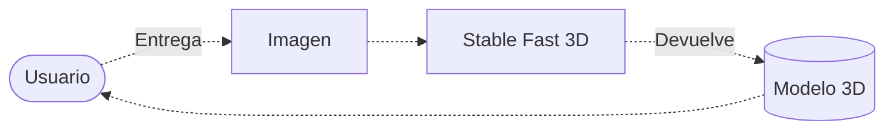
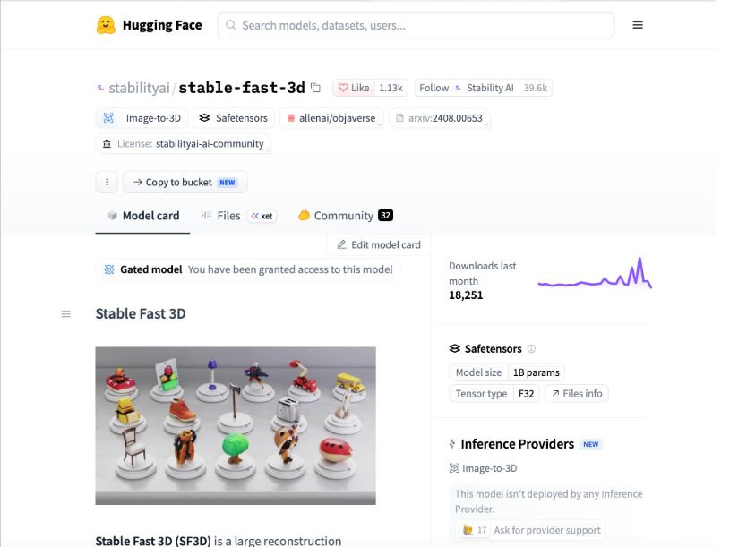

# Modelado de muebles

> Este proyecto modelara en 3D los interiores de una casa para agilizar el modelado de la propiedad

**Proyecto integrador · Herramientas de IA**

**Grupo:** A1 · **Equipo:** 2
## 👥 Integrantes

| Nombre completo                  | 
| :------------------------------- | 
| Arteaga Martinez Jonathan Gael   | 
| Lozano Delgadillo Carlos Eduardo | 
| Cruz Villa Oscar Ivan            |
| Juarez Oliva Jorge Santiago      |

## 1. Caso de uso

¿Qué necesidad resuelven y de quién es?.

Nosotros agilizamos los procesos de modelado 3D ya que pueden llegar a ser muy tardados, esta enfocado principalmente en arquitectos

- **Entrada:** Imagen de un mueble

- **Salida:** El mueble modelado en 3D

## 2. Modelo abierto elegido

  
| Dato                         | Respuesta                                                                          |
| ---------------------------- | ---------------------------------------------------------------------------------- |
| Identificador                | [stabilityai/stable-fast-3d ](https://huggingface.co/stabilityai/stable-fast-3d$0) |
| Tarea (pipeline tag)         | `[image-to-3D]`                                                                    |
| Número de parámetros         | 1B                                                                                 |
| Licencia                     | stabilityai-ai-community                                                           |
| Limitación o sesgo declarado | No modela humanos                                                                  |

## 3. Viabilidad de hardware

  
$$

\text{Memoria mínima} = 1B \times 4\ \text{bytes} \approx \ 4\ \text{GB}

$$

- **VRAM disponible en Colab:** 15 GB

- **Dónde se ejecuta:** Colab con GPU

- **Por qué:** Porque Colab lo corre bien y no hay necesidad de pagar por un inference provider

## 4. Riesgo ético

- **Riesgo:** Podria usarse para crear replicas de llaves fisicas para abrir puertas o candados  

- **Mitigación:** Podemos hacer que si el sistema detecta un objeto de este tipo modele uno generico, que no las replique tal cual

## 5. Evidencia

cuenta de github: gael.arteaga3107@gmail.com
